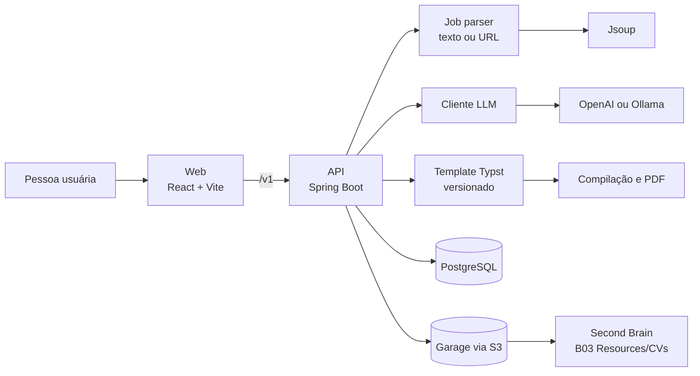
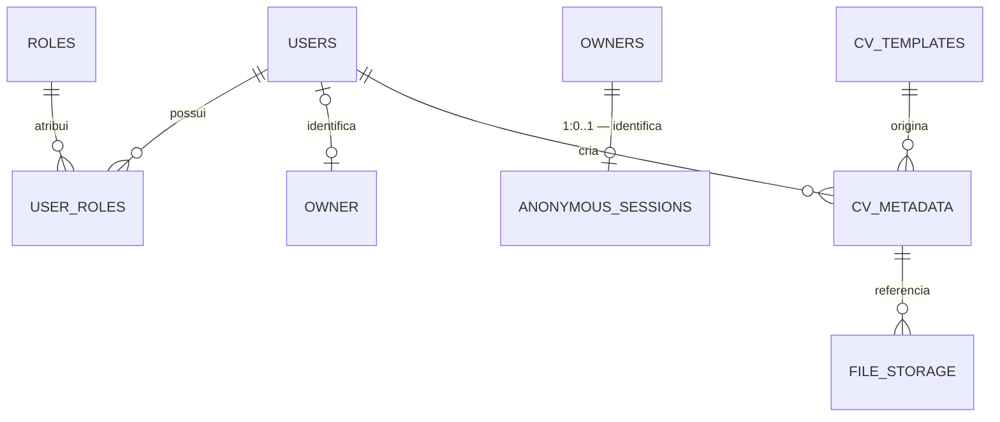

# Tailorly

Monorepo para gerar currículos personalizados para cada vaga. O produto recebe uma descrição ou URL de oportunidade, extrai os requisitos, adapta um currículo a partir de um template versionado e disponibiliza os artefatos para download e acompanhamento no Second Brain.

> **Estado atual:** fundação em andamento. O monorepo, a aplicação web, a API Spring Boot, o proxy local, CORS, Actuator, autenticação JWT e os serviços locais de PostgreSQL e Garage já existem. O fluxo completo de sessões anônimas, o domínio de geração de currículos e integrações externas ainda estão planejados.

## Objetivo e escopo

O Tailorly busca reduzir o trabalho manual de adaptação de currículos, aumentar a aderência às palavras-chave relevantes para sistemas ATS e manter o histórico das candidaturas no vault.

O fluxo alvo é: receber e validar o Currículo Base → aprovar seus fatos como Ground Truth → receber a vaga → extrair requisitos → preencher um template Typst com os fatos aprovados → gerar PDF/Markdown → persistir os artefatos conforme o tipo de sessão → registrar a versão no vault quando a integração estiver habilitada.

## Arquitetura alvo



Os blocos de templates, geração de PDF e vault representam a arquitetura planejada. Hoje a API implementa contas, JWT, upload no Garage, extração por página com OCR seletivo, propostas de fatos por IA com evidência, revisão manual por versão candidata e aprovação atômica de snapshots do Ground Truth. A interface permite consultar o texto bruto extraído por página. A geração de currículos ainda não está disponível; fatos extraídos por IA continuam pendentes até revisão humana.

## Estrutura do repositório

| Caminho | Papel | Estado |
| --- | --- | --- |
| `apps/web` | Interface React para upload, revisão de fatos por candidata, conta e fluxo de geração planejado. | Upload e revisão persistida parciais; geração e download reais pendentes |
| `services/api` | API HTTP e orquestração do fluxo de geração. | Autenticação, upload, extração seletiva e revisão manual persistida; extração semântica e geração pendentes |
| `compose.yaml` | PostgreSQL 17 e Garage para desenvolvimento local. | Disponível |
| `turbo.json` | Orquestra tarefas do monorepo. | Disponível |
| `pnpm-workspace.yaml` | Define os workspaces `apps/*` e `services/*`. | Disponível |

### Frontend

| Aspecto | Implementação |
| --- | --- |
| Runtime | React 19, TypeScript e Vite 7 |
| Estilos e componentes | Tailwind CSS 4, Base UI e componentes locais |
| Roteamento | TanStack Router, com geração a partir de `apps/web/src/pages` |
| Dados remotos | TanStack Query; o `QueryClient` é compartilhado no contexto do router |
| Estado local | Zustand, com oito stores em `apps/web/src/stores` e `resetClientState()` para os fluxos de saída e expiração de sessão |
| Integração local | Proxy de `/v1` para `http://localhost:8080` |

O botão de conta no cabeçalho oferece cadastro, login e logout. O frontend
guarda o JWT em `sessionStorage` para manter o login ao recarregar a mesma aba,
desde que o token ainda seja válido. O logout e respostas `401` da consulta de
conta limpam esse estado. O token expira após uma hora; renovação de sessão
ainda não foi implementada.

A home fica em `apps/web/src/pages/_app/_home/index.tsx` e corresponde a `/`; rotas dinâmicas usam `$id.tsx`; e `pages/__root.tsx` define o layout raiz. O prefixo de arquivo `_app` não aparece na URL. O arquivo `apps/web/src/routeTree.gen.ts` é gerado pelo plugin do TanStack Router e não deve ser alterado manualmente.

**A documentação completa do frontend está em `apps/web/README.md`**: rotas, design system e tokens, as seis dimensões de revisão, regras de pendências, as oito stores e suas guardas de contexto, fluxo da revisão rápida, e o inventário de testes. Ela substitui os READMEs internos que existiam em `src/stores/` e `src/pages/_app/base/`.

Os ícones da interface usam `@react-zero-ui/icon-sprite` (Lucide e Tabler). O `prebuild` de `apps/web` executa `zero-icons`, que gera `public/icons.svg` apenas com os ícones importados; o Vite inclui esse sprite no build. Em desenvolvimento, a biblioteca renderiza os SVGs diretamente. O `components.json` usa `lucide` para o gerador shadcn; componentes adicionados por ele devem trocar os imports gerados para `@react-zero-ui/icon-sprite`.

### API

A documentação detalhada da implementação Spring Boot está em [`services/api/README.md`](services/api/README.md).

| Aspecto | Implementação atual | Evolução prevista |
| --- | --- | --- |
| Runtime | Java 21 e Spring Boot 3.5 | — |
| HTTP e validação | Spring Web, Validation, endpoints de usuários e owners, OpenAPI/Swagger UI | Endpoints de geração de currículo |
| Saúde | Spring Actuator com `health` e `info` expostos | Métricas e logs estruturados |
| Acesso web | CORS, JWT Bearer e RBAC persistido (`ROLE_USER`/`ROLE_ADMIN`) | Política por ambiente e renovação de tokens |
| Parsing de páginas | Jsoup | Leitura de vagas por link implementada (Gupy, JSON-LD `JobPosting` e HTML genérico), com análise por IA e versionamento |
| Dados e arquivos | PostgreSQL/Flyway; PDFs e textos por página no Garage; fila PDFBox/OCR seletivo, revisão auditada e snapshots aprovados | Extração semântica de fatos |

O Actuator pode ser consultado em `http://localhost:8080/actuator/health`. A especificação OpenAPI está em `http://localhost:8080/v3/api-docs` e a interface Swagger UI em `http://localhost:8080/swagger-ui.html`. A API inclui operações de usuários, owners e sessões anônimas. Cadastro (`POST /v1/auth/register` e o caminho existente `POST /v1/users`), login (`POST /v1/auth/login`), saúde, documentação e criação/validação de sessões anônimas são públicos; consulta e revogação de sessões exigem `ROLE_ADMIN`. O login valida email e senha e retorna `accessToken`, `tokenType: Bearer`, `expiresAt` e os dados públicos do usuário. Nas chamadas protegidas, envie `Authorization: Bearer <accessToken>`. O token é assinado com HS256, expira após uma hora e inclui o ID do usuário como sujeito. A API consulta a conta e as roles atuais em cada chamada protegida; contas desativadas perdem acesso imediatamente. Como a autenticação usa apenas o cabeçalho Bearer, não há cookie de login nem token CSRF. Ainda não há refresh token, logout ou revogação individual de JWTs.

Antes de iniciar a API, defina uma chave Base64 com pelo menos 32 bytes e mantenha-a estável entre reinicializações:

```bash
export TAILORLY_JWT_SECRET="$(openssl rand -base64 32)"
pnpm --filter @tailorly/api dev
```

Trocar a chave invalida todos os tokens emitidos anteriormente. Não a inclua no repositório. Fora do ambiente local, defina também `TAILORLY_JWT_ISSUER` com a URL pública da API; o valor padrão é `http://localhost:8080`.

As roles `ROLE_USER` e `ROLE_ADMIN` são criadas na inicialização e persistidas em `roles`/`user_roles`. Todo cadastro recebe `ROLE_USER`. Para definir administradores locais, informe uma lista de e-mails separada por vírgulas antes de iniciar a API:

```bash
export TAILORLY_ADMIN_EMAILS=admin@example.com,other-admin@example.com
pnpm --filter @tailorly/api dev
```

Na inicialização, usuários existentes cujos e-mails estejam na lista recebem `ROLE_ADMIN`; novos cadastros configurados na lista já são criados com as duas roles. A configuração adiciona privilégios de administrador e não remove roles previamente persistidas.

As respostas de erro usam `Accept-Language`. Estão disponíveis mensagens em inglês (padrão) e português do Brasil:

```http
Accept-Language: en
Accept-Language: pt-BR
```

Isso inclui validação, erros de domínio, autenticação (`401`) e autorização (`403`). Sem o cabeçalho, a API responde em inglês.

| Endpoint | Método | Operação |
| --- | --- | --- |
| `/v1/auth/register` | `POST` | Cadastrar usuário (`email`, `password`); retorna `201` e dados públicos. `/v1/users` continua disponível. |
| `/v1/auth/login` | `POST` | Validar `email` e `password`; retorna JWT Bearer, expiração e dados públicos ou `401`. |
| `/v1/me` | `GET` | Consultar o usuário autenticado e seu owner único; cria o owner para contas antigas quando necessário. |
| `/v1/base-documents/upload` | `POST` | Receber PDF da conta, gravar no Garage, criar ou recuperar a versão e enfileirar/reutilizar a extração. |
| `/v1/owners` | `POST` | Criar owner (`kind`, `userId` opcional); snapshot ativo só muda pela aprovação |
| `/v1/owners/{id}` | `GET` | Consultar owner |
| `/v1/owners/{id}/increment-revision` | `PATCH` | Incrementar atomicamente a revisão |
| `/v1/gt-snapshots/approve-version/{baseVersionId}` | `POST` | Validar pendências, congelar fatos auditados e ativar o snapshot atomicamente |
| `/v1/gt-snapshots/{id}` | `GET` | Consultar snapshot e itens aprovados |
| `/v1/job-postings` e subrotas | `POST`, `GET`, `DELETE` | Ler, gravar, versionar e analisar vagas por link ou texto; conta e sessão anônima. Veja “Vagas: leitura por link ou texto…”. |
| `/v1/anonymous-sessions` | `POST` | Emitir sessão anônima (owner, token opaco e TTL gerados no servidor; limitado por IP) |
| `/v1/anonymous-sessions/current` | `GET`, `DELETE` | Consultar uso, limites e se há snapshot migrável; encerrar a sessão apagando seus dados (token anônimo) |
| `/v1/anonymous-sessions/migrate` | `POST` | Migrar o snapshot revisado da sessão para a conta autenticada, sem repetir OCR |
| `/v1/anonymous-sessions/{id}/revoke` | `PATCH` | Revogar sessão (`ROLE_ADMIN`) |
| `/v1/anonymous-sessions/{id}` | `GET` | Consultar sessão (`ROLE_ADMIN`) |


## Vagas: leitura por link ou texto, análise por IA e versionamento

**Implementado.** A vaga entra por link (Jsoup) ou por texto colado, é gravada por owner (conta ou sessão anônima) em versões imutáveis e analisada pela IA configurada. Fica pendente a geração de currículos a partir dela (que registrará a versão usada) e o cruzamento automático com o Ground Truth.

| Rota | Método | Função |
| --- | --- | --- |
| `/v1/job-postings/extract` | `POST` | Pré-visualização: lê o link (`url`) e devolve os dados da página, sem gravar nem chamar IA. |
| `/v1/job-postings` | `POST` | Lê (`url` **ou** `text`, com `title` e `company` opcionais para texto), grava e analisa. `201` para versão nova, `200` quando o conteúdo já existia. |
| `/v1/job-postings/owner/{ownerId}` | `GET` | Vagas salvas do owner, da mais recente à mais antiga. |
| `/v1/job-postings/{id}` | `GET` | Vaga com a última versão e a lista de versões. |
| `/v1/job-postings/{id}/versions/{n}` | `GET` | Uma versão específica. |
| `/v1/job-postings/{id}/versions/{n}/analysis` | `POST` | Refaz a análise por IA (por exemplo depois de uma falha). |
| `/v1/job-postings/{id}` | `DELETE` | Exclui a vaga e todas as versões, com o texto lido e a análise. |

### Leitura da página

`POST` baixa a página com Jsoup e extrai só o que ela declara, sem inferir nada. Fontes, em ordem de prioridade (cada uma só completa o que a anterior não trouxe):

| Fonte | Como é reconhecida | O que fornece |
| --- | --- | --- |
| Gupy | JSON `__NEXT_DATA__` com `props.pageProps.job`, por conteúdo (funciona também em páginas de carreira com domínio próprio) | Título, ID, descrição, responsabilidades, requisitos, diferenciais e benefícios, modelo de trabalho (`remote`/`hybrid`/`onsite`), tipo de contrato, local, datas, etapas do processo seletivo, empresa (nome, sobre, site, logo, página de carreira, LinkedIn, Glassdoor etc.) |
| JSON-LD | `application/ld+json` com `@type: JobPosting` (publicado por sites como Greenhouse e Lever por causa do Google Jobs) | Os campos acima quando publicados, além de salário e habilidades |
| HTML genérico | Open Graph, `h1` e o maior bloco de texto sem navegação | Título e texto; seções só quando há títulos reconhecíveis |
| Texto colado | Sempre texto puro (um `<` digitado não vira HTML) | Seções por títulos como "Requisitos" e "Diferenciais"; o título vem do campo ou da primeira linha, se parecer um título |

As listas `responsibilities`, `requirements`, `niceToHave`, `benefits` e `hiringProcess` são divisões **textuais** por títulos em português e inglês, com tratamento dos itens colados e dos autolinks falsos que a Gupy gera ("Java.Proficiência"). `descriptionText` guarda o texto completo; `warnings` indica `expired`, `job_not_published`, `limited_content` e `sections_not_detected`.

**Validação:** só a Gupy foi conferida contra páginas reais; JSON-LD e HTML genérico têm testes com HTML sintético e ainda não foram validados em outros recrutadores.

**Limites e erros:** sites que só renderizam por JavaScript ou exigem login (por exemplo LinkedIn) não têm conteúdo estático; a API responde `422` (`error.job.no_content`) e a interface pede o texto colado. Links inválidos ou para destinos internos respondem `400`; falhas de rede, `403`/`404` do site e conteúdo que não é HTML respondem `422`.

**Segurança (SSRF):** só `http`/`https` nas portas 80 e 443, sem credenciais no link. O host é resolvido e bloqueado se apontar para loopback, rede privada, link-local (incluindo metadados de nuvem), CGNAT, multicast ou reservados, inclusive IPv6 e IPv4 mapeado. Redirecionamentos (máximo 5) são seguidos manualmente e cada destino é revalidado; timeout de 10 s e corpo limitado a 2 MiB. Risco residual: o Jsoup resolve o nome de novo ao conectar, então um DNS malicioso poderia trocar a resposta entre a validação e a conexão; a mitigação completa exige fixar o IP na conexão (planejado).

### Análise por IA

Usa a IA do owner (`EffectiveAiSettings`: remoto, Ollama ou remoto com fallback; visitantes usam a do servidor) por meio do `AiChatClient`, compartilhado com a interpretação do currículo. O texto da vaga é tratado como dado não confiável no prompt. Devolve senioridade (`intern`, `junior`, `mid`, `senior`, `staff`, `lead`), requisitos com `importance` (`required`/`preferred`), `category`, `minYears` e tecnologias, e a lista de tecnologias citadas. Há dois modos:

- **Anotação (padrão quando há seções):** os itens que a divisão por títulos já isolou em "Requisitos" e "Diferenciais" **são a lista**, um requisito por linha, na ordem da vaga, e a IA só os anota (tecnologias, categoria, anos e se o item não é uma qualificação). A cobertura não depende de o modelo listar tudo, que modelos menores não fazem; um item que o modelo não anotou continua na lista, sem categoria inventada. A importância vem da seção, ou da própria linha quando ela diz "desejável"/"diferencial".
- **Livre (sem seções detectadas):** a IA lista os requisitos do texto, e cada item precisa de um trecho copiado literalmente da vaga.

Em ambos, as tecnologias precisam aparecer no texto (e, na anotação, no próprio item), `minYears` só vale se o item fala em anos (`Java 11+` é versão, não experiência) e uma resposta inutilizável conta como falha. Uma vaga salva com uma versão anterior do analisador é reanalisada ao ser lida de novo (`analyzer_version`).

`analysisStatus` da versão: `completed`; `unavailable` (provider `rules`, sem IA); `failed` (a vaga é gravada mesmo assim e a análise pode ser refeita); `quota_exceeded` (visitante). Sem IA, a interface mostra a divisão do texto por títulos.

### Versionamento e dados

Tabelas `job_postings` (identidade da vaga por owner) e `job_posting_versions` (conteúdo imutável + análise). A identidade é o ID da plataforma quando existe (Gupy), senão o link canônico sem rastreadores, senão o hash do texto colado, e nunca se deduplica entre owners. Reler a mesma vaga com conteúdo idêntico (hash de título, descrição e campos estruturados como prazo, salário e local) reaproveita a versão mais recente e só atualiza `last_checked_at`; conteúdo diferente cria a versão seguinte e as anteriores continuam consultáveis. Texto colado alterado vira **outra vaga**, pois não há como saber que é a mesma. `expired` é recalculado a cada leitura, porque o prazo muda de significado com o tempo. A geração futura deverá registrar o `id` e o `contentHash` da versão usada.

**Visitantes:** a análise consome a cota de processamentos da sessão (`max-extractions`, compartilhada com a extração do currículo) apenas quando a IA é de fato chamada, inclusive em chamadas que falham, e a sessão guarda no máximo `TAILORLY_ANONYMOUS_MAX_JOB_POSTINGS` vagas (padrão 10). As vagas do visitante são apagadas com a sessão (TTL ou descarte) e **não** são migradas para a conta; só o snapshot revisado do currículo é.

### Interface

**Home e Gerador:** os dois têm a entrada da vaga (link ou texto) com validação imediata do link enquanto a pessoa digita (esquema `http(s)`, portas, credenciais e destinos internos, espelhando o servidor; o LinkedIn gera um aviso para colar o texto) e o mesmo botão de gerar. Ao clicar, a vaga é lida e analisada no servidor (`POST /v1/job-postings`) e só então abre a validação dos fatos.

**Validação dos fatos orientada pela vaga:** o diálogo cruza a análise da vaga com os fatos do Currículo Base (`utils/job-fact-match.ts`, no cliente). Só o que a vaga nomeia (tecnologias e competências) é procurado nos fatos, por nome inteiro (`Java` não casa com `JavaScript`) e tolerando variações como `Node.js`/`NodeJS`; fatos omitidos nunca contam como evidência. O diálogo mostra "O que a vaga mais pede" com cada requisito como *no seu currículo* (fato confirmado), *no seu currículo, confirme abaixo* (só fato pendente) ou *não encontrado — não será inventado*, e pergunta primeiro pelos fatos pendentes ligados a requisitos obrigatórios, depois pelos desejáveis. Os demais fatos do mesmo item de lista (empresa, cargo e datas de uma experiência que cita o requisito) também entram, porque dão contexto; itens vizinhos não herdam a relevância. As pendências sem relação com a vaga não bloqueiam o fluxo, mas continuam pendentes e não entram no currículo. Sem análise por IA, ou com uma vaga que não nomeia nada procurável, o diálogo volta a listar todas as pendências.

**Auditoria completa (`/base`):** as pendências aparecem destacadas **nos próprios campos** da etapa, sem painel separado, com o mesmo critério do diálogo. O campo pendente ganha contorno, o selo "Pendente" e, quando a vaga pede aquilo, "Obrigatório/Desejável na vaga" com o motivo; a linha do acordeão, o chip de tecnologia e a linha de idioma ganham o mesmo destaque, e o stepper mostra quantas pendências há em cada etapa (e quantas são da vaga). Resolve-se com os controles que já existem: **editar** o campo e salvar a auditoria registra a correção, **limpar/remover** e salvar omite o fato, e **"Confirmar valor"** (ou o ✓ do chip) confirma na hora. Editar ou remover um campo pendente fecha a pendência pela resposta da API (só atualizar o fato a deixaria aberta e bloquearia a aprovação), e campos que a pessoa não tocou continuam pendentes. Ao confirmar (ou corrigir), o aviso de pendência some e o campo ganha o ícone de verificado (círculo com check), também na linha do acordeão, no chip de tecnologia e na linha de idioma; alterar um campo verificado tira a marca até salvar de novo. Quando a última pendência de uma etapa é resolvida, ela passa a "Sem pendências" no stepper e no cabeçalho da etapa (uma etapa sem fatos extraídos não recebe essa marca). Responder uma pendência pelo diálogo também atualiza o rascunho da auditoria, para o próximo "Salvar" não sobrescrever a correção em silêncio.

**Pendente:** a geração em si. O teste e2e `quick-review.spec.ts` ainda descreve a prévia com dados fictícios de uma versão anterior do diálogo e precisa ser reescrito.

Na página do Gerador, "Detalhes da Vaga Alvo" mostra, depois de gerar (ou ao abrir uma vaga salva), o resultado da leitura: dados da vaga, requisitos obrigatórios e desejáveis com tecnologias e anos, senioridade, benefícios, etapas, empresa com links para conferência, histórico de versões, avisos e exclusão. Não há botão separado de "analisar": gerar já lê e analisa a vaga, o que também evita gastar a cota de IA do visitante duas vezes.

## Requisitos

### Requisitos funcionais

| ID | Requisito | Descrição | Prioridade | Estado |
| --- | --- | --- | --- | --- |
| RF01 | Ingestão de vaga | Aceitar descrição da vaga por texto ou URL. | Alta | Implementado: URL ou texto colado, persistência por versão e análise por IA (`POST /v1/job-postings`); falta usar a versão da vaga na geração |
| RF02 | Extração de requisitos | Identificar responsabilidades, qualificações e palavras-chave relevantes. | Alta | Planejado |
| RF03 | Geração de currículo | Produzir currículo personalizado a partir dos requisitos e do perfil base. | Alta | Planejado |
| RF04 | Exportação | Disponibilizar o currículo em PDF e Markdown. | Média | Planejado |
| RF05 | Metadados e histórico | Salvar autoria, data, status, template e referência do arquivo gerado. | Média | Planejado |
| RF06 | Integração com Second Brain | Copiar/registrar artefatos em `B03 Resources/CVs/` e criar link para uso no Obsidian. | Alta | Planejado |
| RF07 | Acesso e autenticação | Permitir uso anônimo com sessão temporária e cotas; exigir conta para histórico persistente, com papéis quando necessários. | Alta | Parcial: conta, papéis e acesso anônimo (servidor e interface: sessão, limites, TTL, limpeza, migração) implementados; limite de gerações aplicado quando a geração existir |
| RF08 | Due diligence de empresas | Consolidar sinais públicos para apoiar a decisão de candidatura, com fatores e fontes rastreáveis. | A definir | Backlog |

### Requisitos não funcionais

| ID | Requisito | Critério ou diretriz | Prioridade |
| --- | --- | --- | --- |
| RNF01 | Desempenho | Gerar um currículo em até 30 segundos, considerando o tempo de provedores externos. | Alta |
| RNF02 | Escalabilidade | Suportar até 100 usuários simultâneos como referência inicial. | Média |
| RNF03 | Segurança | Proteger dados e credenciais; aplicar autenticação, autorização e configuração por ambiente. | Alta |
| RNF04 | Usabilidade | Oferecer uma interface clara para envio da vaga, revisão e download do resultado. | Média |
| RNF05 | Manutenibilidade | Manter responsabilidades separadas, templates versionados, migrações e testes automatizados. | Média |
| RNF06 | Compatibilidade | Suportar as versões atuais dos principais navegadores. | Média |
| RNF07 | Resiliência | Usar Ollama como alternativa quando o provedor remoto de LLM falhar e definir recuperação para indisponibilidade do storage S3. | Média |
| RNF08 | Observabilidade | Expor saúde da aplicação e evoluir para métricas e logs JSON. | Média |

## Modelo de dados planejado

| Entidade | Campos principais | Responsabilidade |
| --- | --- | --- |
| `users` | `id`, `email`, `password_hash`, `enabled` | Credenciais e estado da conta. |
| `owners` | `id`, `kind`, `user_id`, `active_snapshot_id`, `revision`, `expires_at` | Identidade proprietária de dados; `user_id` é opcional e único. `active_snapshot_id` aponta para o snapshot aprovado quando o modelo de snapshots existir. |
| `anonymous_sessions` | `id`, `owner_id`, `token_hash`, `expires_at`, `revoked_at`, `created_at`, `uploads_count`, `extractions_count`, `generations_count` | Sessão anônima emitida pelo servidor, com token armazenado só como hash, expiração/revogação e contadores de uso para as cotas; cada owner tem no máximo uma sessão. |
| `job_postings` | `id`, `owner_id`, `source_kind` (`url`/`text`), `source_key`, `title`, `company_name`, `expires_at`, `latest_version_number`, `created_at`, `updated_at` | Vaga de um owner, única por `(owner_id, source_key)`; título, empresa e prazo são cópias da última versão, para listagem. |
| `job_posting_versions` | `id`, `job_posting_id`, `version_number`, `content_hash`, `details` (JSONB), `analysis` (JSONB), `analysis_status`, `analyzer_version`, `analyzed_at`, `created_at`, `last_checked_at` | Leitura imutável da vaga mais a análise por IA, que pode ser refeita. |
| `roles` | `id`, `name` | Papéis de acesso, como `ADMIN` e `USER`. |
| `user_roles` | `user_id`, `role_id` | Associação muitos-para-muitos entre usuários e papéis. |
| `cv_templates` | `id`, `name`, `content`, `version` | Templates Typst versionados para apresentação; os fatos aprovados do Currículo Base são o Ground Truth. |
| `cv_metadata` | `id`, `filename`, `created_at`, `status`, `owner_id`, `template_id` | Histórico e situação de cada currículo gerado. |
| `file_storage` | `id`, `file_path`, `cv_metadata_id` | Modelo planejado de referência a artefatos em storage S3. |



## Decisão de produto: Currículo Base como Ground Truth

Esta seção descreve o **fluxo alvo**, ainda não implementado de ponta a ponta. O Currículo Base é a fonte dos fatos pessoais e profissionais; o template Typst controla apenas a apresentação. Uma conta ou sessão anônima pode ter **um Ground Truth ativo** por vez, mas versões anteriores podem existir para auditoria e para identificar a origem de currículos já gerados.

### Processamento, versões e pendências

1. Ao receber um arquivo, calcular no servidor um hash do conteúdo (por exemplo, SHA-256) e consultar versões **no escopo da mesma conta ou sessão anônima**. Um arquivo idêntico já processado reutiliza a extração e os fatos; não executa OCR nem duplica registros. Uma nova visita anônima após a expiração da sessão pode exigir novo processamento. Não fazer deduplicação global entre pessoas.
2. Para arquivo novo, criar uma versão candidata. Extrair texto diretamente de PDF/DOC/DOCX quando possível e usar OCR nas páginas que precisarem. Extrair fatos estruturados com IA, preservando, para cada fato, o trecho ou página de origem, o estado de revisão e as versões do extrator, modelo, prompt e esquema.
3. Criar pendências ligadas à versão candidata para fatos ambíguos, ausentes, conflitantes ou sensíveis ao tempo. O usuário pode confirmar, corrigir ou omitir cada fato. Mudanças de arquivo não herdam respostas automaticamente; confirmações de fatos ainda atuais podem ser reaproveitadas somente após comparação e validação. Um arquivo idêntico dispensa novo OCR, mas pode exigir nova confirmação de fatos como vínculo de emprego atual.
4. Ativar a nova versão somente depois das confirmações obrigatórias, em uma operação que desativa a anterior. Enquanto a candidata é processada ou revisada, a versão ativa anterior permanece válida. A geração usa um snapshot imutável dos fatos aprovados e registra a versão do Ground Truth e da vaga usada; ela não reexecuta OCR para cada vaga.
5. Uma atualização do pipeline pode propor uma nova extração, sem sobrescrever silenciosamente fatos corrigidos ou confirmados. Saída em JSON válido ou com esquema rígido não equivale a exatidão factual; o snapshot aprovado evita que novas execuções da IA alterem o Ground Truth sem revisão.

**Trocar**, **desativar** e **excluir** são operações diferentes. Trocar ativa uma nova versão após revisão. Desativar deixa a conta ou sessão sem Ground Truth ativo, sem apagar automaticamente o histórico. Excluir remove arquivo, texto extraído, fatos e pendências da versão solicitada; o produto deve informar o efeito sobre currículos gerados anteriormente, que também podem conter os mesmos dados pessoais. Uma solicitação de exclusão completa deve abranger esses artefatos conforme a política de retenção definida para o produto.

### Uso sem conta e persistência

| Aspecto | Sessão anônima | Conta autenticada |
| --- | --- | --- |
| Identidade | Identificador de sessão assinado no servidor; sem cadastro. | Identidade da conta. |
| Estado | Arquivo temporário, extração, fatos, pendências e snapshot aprovado com expiração automática (TTL). | Versões, revisões e histórico persistentes. |
| Deduplicação | Hash reutilizado somente enquanto a sessão existir. | Hash reutilizado entre envios da mesma conta. |
| Limites | Cotas de tamanho e páginas, processamento, gerações e taxa de requisições verificadas no servidor. | Limites do plano ou da conta. |
| Fim do ciclo | Expiração ou remoção apaga dados temporários; não há histórico durável. | Exclusão explícita e política de retenção. |

A sessão anônima pode usar armazenamento temporário no servidor, mesmo sem criar um usuário no banco relacional. `sessionStorage` no navegador guarda apenas estado de interface; não é fonte confiável para cotas, cache de OCR ou fatos aprovados. A API protege credenciais e aplica limites. Se a pessoa criar conta antes da expiração, oferecer a migração do snapshot já processado e revisado para a conta, sem repetir OCR. Sem migração, os dados expiram. A interface de “Últimos Currículos Gerados” deve mostrar um estado vazio ou de prévia para visitantes sem histórico, nunca exemplos como se fossem documentos reais da pessoa.

### Dados a modelar

Além de `users`, templates e artefatos gerados, o domínio precisará representar versões do Currículo Base, execuções de extração, fatos com evidência e estado de revisão, pendências e respostas, sessões anônimas com TTL e a referência de cada currículo gerado ao snapshot aprovado. A versão ativa deve ser única por conta ou sessão; versões anteriores não são o Ground Truth ativo. Arquivo original e texto extraído podem ficar em storage apropriado, enquanto metadados, fatos e decisões ficam no banco. As regras de retenção e exclusão devem cobrir ambos.

## Pré-requisitos

| Ferramenta | Versão |
| --- | --- |
| Node.js | 22.18.0 ou superior (ou 24.11.0 ou superior) |
| pnpm | 10.9.0 (gerenciado pelo Corepack) |
| Java | 21 |
| Docker Compose | Opcional, necessário para PostgreSQL e Garage locais |

## Desenvolvimento

Instale as dependências. Para executar a API local, crie antes
`services/api/.env.garage` e inicie os serviços de apoio conforme as instruções
abaixo; o script `dev` da API carrega as credenciais S3 desse arquivo. Depois
inicie os dois workspaces:

```bash
corepack enable
pnpm install
pnpm dev
```

| Serviço | Endereço |
| --- | --- |
| Web | `http://localhost:5173` |
| API | `http://localhost:8080` |
| Health check | `http://localhost:8080/actuator/health` |
| OpenAPI (JSON) | `http://localhost:8080/v3/api-docs` |
| Swagger UI | `http://localhost:8080/swagger-ui.html` |

Para iniciar apenas uma aplicação:

```bash
pnpm --filter @tailorly/web dev
pnpm --filter @tailorly/api dev
```

Para disponibilizar os serviços de apoio locais:

```bash
bash services/api/init-garage-env.sh
docker compose up -d
```

O script cria `services/api/.env.garage` com credenciais de desenvolvimento não versionadas e um token para a Garage UI. O Garage inicia em modo de nó único, cria o bucket privado `tailorly-private` e expõe apenas a API S3 local. A interface visual de terceiros fica em `http://127.0.0.1:3909` e usa `GARAGE_ADMIN_TOKEN` do mesmo arquivo para login; consulte as [instruções da API](services/api/README.md#interface-visual-do-garage). O script `dev` da API ativa o perfil Spring `local`, já alinhado às credenciais do PostgreSQL no Compose. Esta configuração não migra objetos de um volume antigo do MinIO.

Se a porta `5432` do host estiver ocupada, inicie com `TAILORLY_POSTGRES_PORT=5433 docker compose up -d` e use `jdbc:postgresql://localhost:5433/tailorly` na API. Com `sudo`, execute `sudo env TAILORLY_POSTGRES_PORT=5433 docker compose up -d`.

| Serviço | Endereço | Credenciais de desenvolvimento |
| --- | --- | --- |
| PostgreSQL | `localhost:5432/tailorly` | usuário `tailorly`, senha `tailorly` |
| Garage S3 API | `http://localhost:3900` | chave e segredo em `services/api/.env.garage` |
| Garage UI | `http://127.0.0.1:3909` | `GARAGE_ADMIN_TOKEN` em `services/api/.env.garage` |

Essas credenciais existem apenas para o ambiente local. Variáveis de ambiente e segredos de produção não devem ser versionados.

## Comandos de qualidade

| Comando | Finalidade |
| --- | --- |
| `pnpm build` | Gera o build de todos os workspaces. |
| `pnpm test` | Executa a suíte de testes do monorepo. |
| `pnpm lint` | Executa as verificações de lint. |
| `pnpm check` | Executa as checagens configuradas para os workspaces. |
| `pnpm api:generate` | Regenera tipos e funções HTTP TypeScript a partir do snapshot OpenAPI versionado. |
| `pnpm api:sync` | Com a API ativa, atualiza o snapshot OpenAPI e executa o Orval. |

O contrato consumido pelo frontend fica em `services/api/openapi/tailorly.json`.
Use `pnpm api:generate` no trabalho cotidiano e `pnpm api:sync` sempre que um
endpoint ou DTO do backend mudar. O código em `apps/web/src/lib/api/generated`
é gerado e não deve ser editado manualmente.

## Próximos passos

**Ponto de partida:** cadastro, login JWT, `/v1/me`, upload autenticado no Garage, deduplicação, extração por página, revisão manual e aprovação atômica do snapshot já funcionam. Texto extraído ainda não se torna fato automaticamente, e gerações reais ainda não existem.

**Próxima entrega recomendada: extrair fatos estruturados automaticamente e anexar evidências por campo.** A sequência abaixo separa a implementação existente do trabalho necessário para chegar à geração real:

1. [x] **Fechar o ciclo do documento no frontend.** Home e `/base` usam o mesmo fluxo autenticado e mostram o status do upload atual. A interface não lista documentos antigos nem oferece prévia remota; o estado local desaparece ao recarregar.
2. [x] **Criar a versão candidata no backend.** O upload cria ou recupera a versão no escopo do owner, com status e numeração definidos pelo servidor. Reenvio idêntico reutiliza versão e execução compatível e marca revisão temporal pendente; o snapshot ativo não é alterado. Fatos e reavaliação temporal continuam pendentes.
3. [x] **Processar o PDF no servidor.** Fila persistente, PDFBox por página, OCR seletivo com Tesseract local, textos no Garage, hashes e métodos estão implementados. O worker só marca a execução concluída depois da interpretação IA, validação das evidências e persistência dos fatos; falha de interpretação mantém a versão candidata e execução não concluídas. A interface acompanha o status sem percentual por página; a análise nativa separa artigos/colunas e suprime texto sobreposto. Há um teste OCR real opcional com uma página escaneada representativa, executado quando Tesseract 5 e `eng` estão instalados. A detecção de texto misto e a reconstrução geral de layouts continuam limitadas. Veja o [guia da API](services/api/README.md#extração-seletiva-de-pdf).
4. [x] **Persistir fatos e revisão por candidata.** A API armazena fatos, evidências de páginas extraídas, pendências e decisões auditadas com os estados `pendente`, `confirmado`, `corrigido` e `omitido`. `AiCurriculumInterpreter` usa OpenAI e Ollama local como fallback; `/base` permite revisar propostas reais. A extração semântica exige saída estruturada com evidência literal, mas não confirma a veracidade dos fatos. A revisão humana continua obrigatória e novos processamentos não sobrescrevem fatos revisados.
5. [x] **Aprovar e ativar o Ground Truth.** `POST /v1/gt-snapshots/approve-version/{baseVersionId}` exige versão extraída, ao menos um fato confirmado/corrigido e nenhuma pendência bloqueante; congela os valores com hash e referências às decisões e ativa o novo snapshot na mesma transação que substitui o anterior. A rota genérica de alteração de `activeSnapshotId` foi removida. A geração baseada no snapshot segue pendente.
6. [x] **Completar o acesso anônimo antes de liberar o fluxo para visitantes.** *Servidor concluído:* a sessão é emitida e autenticada pelo servidor (token opaco, só o hash fica no banco); upload e processamento por owner anônimo respeitam limites de tamanho, páginas, uploads, processamentos, gerações (o ponto de aplicação existe; a geração ainda é planejada) e taxa de requisições; os dados têm TTL e são apagados por um job de limpeza; o snapshot revisado pode ser migrado para uma conta antes da expiração sem repetir OCR. O processamento anônimo usa sempre a IA das variáveis de ambiente do servidor. *Interface concluída:* o visitante envia o PDF, acompanha a extração, revisa e aprova sem conta; a sessão é criada sob demanda, o token é a credencial das chamadas e, após o login, um diálogo oferece trazer o currículo aprovado para a conta ou descartá-lo. *Planejado:* a aplicação efetiva do limite de gerações, que depende de o endpoint de geração existir.
7. [ ] **Implementar vaga e geração.** *Concluído:* receber URL ou texto, extrair requisitos (Gupy, JSON-LD, HTML genérico), versionar a vaga e analisá-la com a IA do owner. *Pendente:* o restante desta etapa, a partir da geração. Versionar o template Typst e criar `POST /v1/cv/generate` a partir do snapshot aprovado e da versão da vaga, sem refazer OCR nem acrescentar fatos pessoais. Gerar PDF/Markdown, persistir artefatos no Garage e disponibilizar download e histórico reais.
8. [ ] **Fechar o ciclo dos dados.** Implementar desativação e exclusão efetiva de originais, texto, fatos, pendências e artefatos derivados, com política de retenção para contas. Cobrir as transições do fluxo com testes de API, contrato e interface.
9. [ ] **Preparar operação e integrações.** Definir renovação ou revogação de tokens, integrar os artefatos gerados ao Second Brain/vault quando habilitado e preparar CI/CD com GitHub Actions.

Após alterar endpoints ou DTOs, execute `pnpm api:sync` com a API ativa para atualizar o contrato OpenAPI e o cliente gerado. Atualize os READMEs da web e da API conforme cada etapa passar de planejada a implementada.
