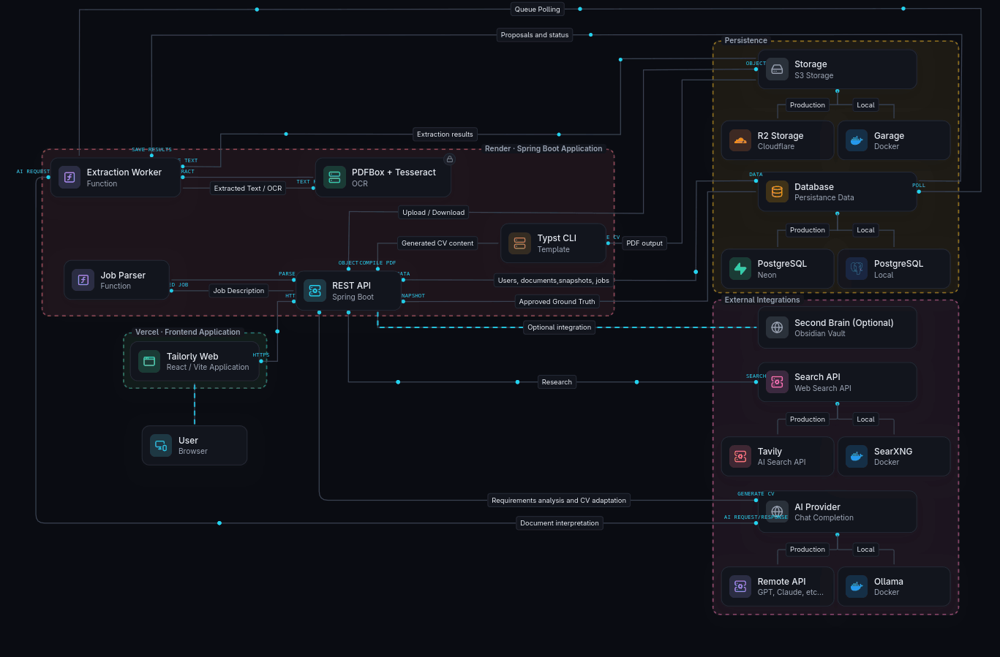

# Tailorly

Gera currículos personalizados para cada vaga **sem inventar fatos**. Você envia o seu Currículo Base
(PDF), revisa os fatos que a IA extraiu — o _Ground Truth_ — e, para cada vaga (por link ou texto),
recebe um currículo em PDF e Markdown montado **somente** com o que foi aprovado. Cada geração traz
nota de ATS, prévia ao vivo de um template Typst editável e histórico. Visitantes podem usar sem conta,
com sessão temporária e limites aplicados no servidor.

> **Status:** projeto pessoal em desenvolvimento, sem versão de produção estável. Roda no free tier
> (Vercel + Render + Neon + Cloudflare R2), voltado a poucas pessoas. Limites e cuidados em
> [Deploy](docs/deploy.md); o que ainda falta em [Roadmap](docs/roadmap.md).

## Visão geral

<a href="https://www.gravelgraph.com/#d=3VzrcuO4sX4VlvJjNnUsmfeLJpMqX-QZ7_HYXkue3ZN4ywWSkM0MRSokZY93ys91_ufJ8gG8gRR1seVsJZmt2hkCIIgGvm50f2joe--BJmkQR72hstcL_N6w599ONWqbiqL39npZkIUUhaezeZxk1JemSTyTPtNkRtAY9fd0xup9knzFYxT7NO0N__o97yq6Ja6hWj7xWNOnOWt5l8SLOR7ncRpk_MPfe996Q82xBrZty7ph67qpOLq513vqDQ1tYFmmrFq6paq24yjPe_hWRthbX4OIfaTsMCQuDfF8RSOfJtI__l8az5MgupMO4ziTDubzMPAI_-Jez4vDOEHbP0xdS7GNHnp9DPzsvjd0dHWvd0-Du_usN1Qdea_32yn6wwj1571KLGo4vqvIfIbWiqXoljmwDNs0LMNxdEW1uVh9RZUHmmrItqLrhon_ofdNgl2ylUozGnm0KYI7VXVBBF2xahF0FQ-lCH1MXyWDTj2Daj7r61UyqI450GUN62satqw45hYijL5lNIlIKJ1GGb1L-HKkDWGwzq65ShiDfbpTGAtjc1XTrYUhiXe_LIthOgNFVizVMWTFMHUtR5nsQBTbNmRVc2RLNY1lUbwwoFEmyHKd0gSP6cItSw6T-JEV1qNXLACoHD2boGrAmqo66tR2Ng7YkDsGrFnawJEdSzYcQAcrsTzeR-qSuTj3ExJgksMn6WfKpkkY9xUlXibtS1-CjDYUpRZElTHznYI41FVc1TM3CaIr9sCSLWi3rsmmpRQKrsrmwNBMU9NNiOrImrosCpkHon6PxhPp4PK0KYOg66vnH4MiCVbxtGWcBHFcwzcUldibxFHRGRt-B-ini8gr7IyA-wRzjELp5zj52gbOSfmGMOHKi0dOportTJWNC2EMHPFPLgheHSimDHVzoMtOhwJ0iPVj7EqXJFlShA55Xr4SuqUYhm1tVGmdaYiiOIaO9potG6tXBgN9CLj1rGzq8clh_E36H2lCU9RijZqSXBxdsdax95WigyxZUHGJnBeKZJm-rzm2tkkkS7cHUAxd0Qwsh2pga2ZLpEHQtUu0LN_kaZ5m0tFZS1smdDYPSdbYR1zD1gyym_LoOvZofaPy2NpAgfmCwpuWZZiw8GzBOvZ2WuwXgkRj6sWRLx0mJIikHy7mrFsS_rG1bG4a-AGJpC9kEYoGQTVgdiqZYNMaMlVboiCTp5iEmtorZeoCYRYn5E5cpHFVIho0TarLq0VydKK59kqB2otU-Smi72K5xDd1a0sLp2j2wLAdy1QdAAJY1LYR6UoVRi9IdRTGC38aYoyiVCdQW1VGSYC15Xtt1UqAoy14ZltJ6rmyqvr-xj1WVZSOtdNgKDVTlRUNro1sw1tbFpw9uiRtWJQ4ze4SOv7prCn5WexxHFdC64rpjJi1LoTGoNiL6U4iu_LUU4iy0Wh2i7zVWi_ZmI9keZ2PmcVku0Ilrqo75ui4FtfPW-wirKpSxfCI-jrVVDEDa61px-Ie10WCsIVjTuCYS6zFTuppYpC-6Wyrnm-M0nPajI-0k6MTe1SvWrqY513tsm66rMiW62x0GTvXTVHkgW3otiyrtoHQRO3AaNNhHFPW_bLLCD9YatStjkLWL2PXtuErlu2bhhD4rvcjsbebJhxhQ8N_bB03STUhD0H41JTo4HSVQO0wd_2idQlk2o5hK3SjsnVblm3kW7YsTJhfzj_-i02LEAiXsaUYWvqe7UDLNipkJ1o1xRqYloEgH76srnWJ3eHjYB0vk_ghAI_R2j7vCby5GM4bbTMZGzyDbVwd12Ph_HSjXhaY1TVn4KjM6bZsMAO61WF6WqEbncUsxGxr4sfLyZ50FJKFT_ckmnmDwUAUzVZsbyqK9nL06rIv21PNeB16t5F0Gb0XYUhm5PcCrxiSu4oHzmy6kdkBn9Ig3YxiS3EGKoIB1XJ0TTFNZzOv84UmHg0lRrqdJDG4HXjoKxg3TUcI5DRwKsiHQK7B8Py616P-ncgp0ltPtRCpKMwSpfECH14K3ElyR9FZM4jM234ikc8ZTbYIecOqiKlgMWHTMH7EUyk2iYJZLgkeaETcsAwH0SZIaB7t4rU4eSQJI0bTOWVNIE290qqvUQYQn0ZYBraXoV32xL_txxkjwrL4K43OStbgl8nVwdGEzdWcPIUxQYfVEvwtLeaVzTYT9vtNJEk3DD-LGcfHTW-YP9_aU1UhN729vEU-EayWv8KK3AVAl-UvZAVPVLRn1V8pnlhd_BjB19n_zv8-9Z_34yS4C2C8ULZYBP7zYO5Pb3rsvefiazGP0NLG52DyWKh9jil9oBM8sVo-m1ULPseIvpdqYi85I9HdAi4n7_SvN0B1gsHyt-5uer_yr99Ez73n50opKPYvYriU81QCakQarkaNwGltgRrB2X4lbNwYilBhBhTfGsxAWdZh5tNkcjlmiIGGZmDEeHRGue4vQeg-y1hFDaHLC1Br-w_KfgmiVGL97cMm3kRHebM-KAU6lGaIqwNYomwfmJ_1mcTvJTdeRDgJePrQx5-SbzwsCm-im4iVd9WUfR8HaWmihpLQcURm9MNNbxqEwO17if1dFCFgwkhL2DXHCP6ztED7rAEG8CcQPpILxCZPEuv6z4JyXUynKQNATno7BVOvqg0YWZo7teScQRWMj8C9bQUjjpltrY9Itx3T1EsCrlOl_YUv3xvKAwPW-_V2ChZ_W1M1X4Q8lmjg7vLgajw6ln68ONwSfKvsFz9xyq3NIYFVwk5yTB9oGM8p0_K8kQcXiESFURp9I8wh4n4RLywa4SiqnKq8YdGPhBmXcH4VwdJFklt8JH3CUGcpXI-qg4T-fYFJ44qQm5rCBv1IHkpzyh4F7lkorUMsobAkr9EfK_q1-hJwj5l2gxDgLw1b8Q6WPLgTBpo7GmhT9fq5FEbomRvAbmyD1mMrajWArcM-WtRhAYsAbJHdr4EtwL0F7JD5Oy1gc5v5ttsq0L7LxsrB-gZY7dhJmaA52q6vxIV_IOGiqGBmNx3u79MctwOAef9vsZvuFyvc92u8izspgyPFGP2TgIZ-EyOF1lSfa2C_Km0CWihuo28TgvpKfnoD62g2UOSpCHUsg_nZu_hmXeZx9TbbOmXBKTXzKXCglbP326IswbTjLGNb5w3b9FqLOIH7Jl2NDo7_760duHnt-_AVLMBXVp0vZi7DzlBSiiUWfC6I-plm93HROTv_uPilwgKHUuGPwa7F0wx6R6VRBCeP4lD9McjuJfoN0MRhKNgumBxmC7nRzHvIwbpmTOrGMU1G4_GIOb4rhjXyF_mmPuQmf4HwWRp7fEDiQET7msUZCS_LaVOXnENF06cq4WkKAmxF6r-GrcCft2DbgVp2nLQetAj0IU-xn_9Occay1Wu4OIasUdOsBVwzGQLf_BaTUZLk3fMwRZyxaSLUF-4M66dCm8qEulN2NCFMhcg711MhELf_nbggjsOOVxkCNk6GcPTyb4KLN5wInxgIJc3WRIisdj0RAg_8H4uKpuyUujJthdHdsguU8X8kCES55amNkzFSu7xL3LBgFGse9b9izVWHekj7ajl13bILROu_x5rLSF3bAe625ZCp3toAxDwOwebVO-ROrJGQmyLBCMHBaUX6CsuJ2yHU335COh3b8cGXkXT05dUk0zU4piUi8Y7iH3k-4P73-oFV1RTPSjaqi-n5mHeCaGBbzqdfpA4putYAgW15mmm1QdAdGgvQaIEgexXnU0tx9EUqJ7FF_NgIRX4X5qcrlj66-Hx5ejZik7wlIpgn30DEH7AEEosSfpgThBbMxyf6Te-PNxGvYe1_mKI1qzgLEEfgC4sUR51JANYPzW6iD-zAbIocLp4NJF1xyPCKD9J4MZtxlrHkk6r4uh3PsPCheOdrEIYpCEse37C_hRPztbSK09w2FN8wPJsdxWyEzmr7we3kS5FzPWcjRBR8DCXjS9CEjaq9ADZNhnqnU42Lwx9H-aHG21mPrmMIwVh8wtoNpT8laj8_6OgDBfMYnNmfNxqSsvoMZwvZPTph3HM_DX6jePdbn8x-6xeD66f3BGeuaJL_A_Uv4Jv7qpyn9iosDe6RPPHx5edeqEZibF7LUpNzglqzcg5GMe12Ud_Unn9txDGOo1rUalmwblpmzTbWQe7lhN82tAxLfmWmPOSQEJGIc_EdDNj64xLYts2bGaNq3haQNbOB0mTB9zFO2wCQGbipVRsZs3X7SM0MoveSd89Sa7MPi2zatxmYXsLHrMKZZuZAAoPHDrGXgGY6OYQcpNU0CnS5QpmGvFdWwrMkxJK-jRNbEXcICXyVuC2vuRt3QiC5xc6ZY3GT34zDJBgFTvgjPytbLCFvpzOTbc_pVgMPxwHXZ5Ntz-vSv-cJhCX0Ts_Bk02k0_PJBUBQAu52Xsn9Q06FCXWA4m3gF7RayTTWJfmrFFeA0D4tCvOZu4mw0X45OLsejct-h43ehsvdwUGvu3l3eXWBA8bR8Tt09Z7h-fry-GAyEofHaHDgfDQpPip9kN4xB-NsNOHv_fxpdDWSAh_lQ7TFl96vNKg2y5vgSNesLqQbdp7u0EfueAlkJENU93PqssLOKmYL3NZUodTkGR4bT0zqzOh2WPQqt7DMe4bGVxdpfp_okKT3W8KV7ZQNvJbnvvu5e5buFw5ZvzrgG8z8VetZuOZyw71yfNO2fWGvWrMEq-3LK_c1dgEo3au0KN1LIzJP7-Hy7EkMyC1bo73e31rPWwgHEV3-FnTs4JUG5nD08fScq6poaurkgMIOVPrOt79a_ctj-uKx6PeWzarQ4vYekOqyLh32pPWBd3Vo-K4sanlwZfkwd8pK09Mlz21xFbKSa3kAq03hctt3Rwfnx6fMwlUGb4XBZmB5o2_-dD26FiwsbOfn08lqG6kW53gKu6ewZCFxRyuPaXDFr7SGSBPrtoaORWyLyq1Tgxer4qusIVLNkC6JGPkjQI69fpIsuPq8Wv3eNo_r7OLgWBqfH1yOP11s62e2VXE8OkPUVCCisDMCRsoSpktFGRSBT0q-l99EJ1cXnyWWuBf5t5A4u7-t7FW5sZbqxbbX8t-sMwBZ_CirZtB9oFUXa3di3NzlmGG3FDtAZuXOoyZX23BZBMeyCTJwzFPdJK3sm26QCZz0ZiZyM8awZ_HU6l3Il6ZVRwi-nnnBlrcOVuPRwdXRpx1TGJBSAGqkK49GesRNRYQiCCs8BG0LxB04IQ_oY5k6wNJw0Ft-LFslQGyRmsOaweZN1mb6iJkPM_KNuQyIHFlzY01iglYirZHaYkxNiizZbVAjsNpt1LzOS7gSci4QiJDwCXdFeEQCQo_4ZA7zvpzMZe4CqxcS3i1YfRyd4_QdfnlO8b4gc4ukX_PlPPpye3B8cDk5mJxenFdowZI3U2U2Z3qtycJaysNalYnVzsXKS_Ms0WJkuVXku0ZjhKV1K1MxKmvnqMQThphbWHFsVfpDMydo_L-nZ3VW0FJmUC5PWVmmUry2t2Whi6yIlvRBlAJTOVnRSCo6YOjknM2MSlnMnFo8daYQHcdShF9ZCKIHVLAwsuZia3pCaA_fWYojXEYvdympmMNNmUd64X40szJN2TYtUFytYxrhRwFqDRdSfjfTrLvn9q7lqzTb9XGzYU2o1VLO60vmTHTr5VK8VXvH_At14mh-tlS6j9wxB-PENAe_5yEtENe8S6WSUy0AAGZ8gkr2EQkGLKUhRMS6uU_VSznPsnBnQcZqsnuo1R1ce1aP3w3JrwUsclqaxa0J1pyuZKr6SPMv2Mxm0Gc5tier7fyUF5NKL8pULK35Twu6oDgLCEO237bIJHZb5F-UbLbBFbi8OOPHEjs4AlDu0swxZkVXXKfOpN2YklYQn8ItgVtLLU0kDGcew_DaPESpqgiwMptzHwJs6OqMQ9xHLagZu5PO0c2Cg8SlztKPdNgN_bwMF6-aZUu-pWbKruY6W3Hkq70E7ki--KgX14JyVeRqMU9op1Ngv-Tct-0UrPcJNtwqwIW0qxEWbjzZB2V5eYE49rW-AaM8P49uT5Dfd1tccBGdhLC425E3nmf9Q1wBacGwsUcjQunEZFeiZGsnXZUsuXsW5As32uKEhO-Bi8riol92BYIvtphXjlqkgFMpR54EnxzL2NhdTyMvxF06fqYqRVzC3OVkUkkx16vO3XsK6RYRLvmWv_a03aasFrqH--LP7MoWixJYD2W1rcOhxY8p2aZuqI5dNLaUgWHZsqmYmuHg95_Yb_vE8Yx7sLqs47eFEMA5moJKfHcGnWD9eQllx-EHDFwqtgHQt31ZnagKKAm4BQPVVP8CBC7m0LF2M20i6_jdoqGGn0DRjb8wcVKWVI3ZO41OwvwKmvb8Tw" target="_blank" rel="noopener noreferrer">
  
</a>

> Clique no GIF para abrir o projeto completo no Gravel Graph

## Principais funcionalidades

- **Currículo Base como Ground Truth:** upload de PDF com extração de texto direta e OCR apenas nas
  páginas que precisam; fatos propostos pela IA com página e trecho de origem.
- **Revisão por fato:** cada fato fica como `pendente`, `confirmado`, `corrigido` ou `omitido`. Ao
  aprovar, o servidor congela um snapshot imutável e o torna o Ground Truth ativo.
- **Vagas por link ou texto:** leitura de Gupy, InHire e Trakstar Hire (validadas com páginas reais), JSON-LD e páginas HTML genéricas, com análise de requisitos obrigatórios, desejáveis, tecnologias e anos de experiência.
- **Geração controlada:** a IA reescreve e adapta a apresentação à vaga, mas não adiciona fatos fora do
  snapshot aprovado. Evidências complementares (vaga, links, busca web) só entram com fonte citada e
  confirmação.
- **Templates Typst:** quatro layouts versionados (clássico, editorial, Harvard e moderno), com prévia
  ao vivo e editor com destaque de sintaxe.
- **Avaliação de ATS por regras:** o currículo gerado é lido por um parser próprio e recebe nota e
  observações.
- **Exportação e histórico:** download em PDF ou Markdown; "Meus Currículos" com a versão do Ground
  Truth e da vaga usadas em cada geração.
- **Due diligence de empresas (opcional):** onze fatores com fonte, trecho verificado, data e grau de
  incerteza, a partir de fontes públicas.
- **Exportação para Obsidian (opcional, local):** copia PDF e Markdown com frontmatter para um vault.
- **Acesso anônimo ou com conta:** visitantes usam com sessão temporária (TTL) e cotas no servidor;
  contas têm histórico persistente, refresh token rotativo e política de retenção.

## Como funciona

1. **Currículo Base:** upload do PDF → extração (texto direto, OCR só quando necessário) → fatos
   propostos por IA, cada um com a origem.
2. **Revisão:** a pessoa confirma, corrige ou omite os fatos pendentes; ao aprovar, o snapshot vira o
   Ground Truth ativo. Trocar de arquivo cria uma versão candidata sem desativar a atual até ela ser
   revisada.
3. **Vaga:** leitura por link ou texto colado e análise de requisitos por IA.
4. **Geração:** a esteira monta o documento a partir do snapshot e da vaga, compila o template Typst,
   calcula a nota de ATS e grava os artefatos.
5. **Opcional:** due diligence da empresa e exportação para o vault do Obsidian.

As regras de domínio estão em [Currículo Base como Ground Truth](docs/product/ground-truth.md).

## Tecnologias

| Área                   | Tecnologias                                                                                                                  |
| ---------------------- | ---------------------------------------------------------------------------------------------------------------------------- |
| Frontend               | React 19, TypeScript, Vite 7, TanStack Router e TanStack Query, Zustand, Tailwind CSS 4, Base UI, Zod, CodeMirror, react-pdf |
| Geração de API client  | Orval a partir do OpenAPI (springdoc)                                                                                        |
| Backend                | Java 21, Spring Boot 4 (Web MVC, Security com OAuth2 Resource Server/JWT, Validation, Actuator), Spring Data JPA, Lombok     |
| Banco e migrations     | PostgreSQL 17 (Neon em produção), Flyway                                                                                     |
| Arquivos               | Cliente S3 (AWS SDK v2): Cloudflare R2 em produção e Garage em desenvolvimento                                               |
| Extração e OCR         | Apache PDFBox 3, Tesseract (por + eng), Jsoup para leitura de vagas                                                          |
| Geração de PDF         | Typst CLI (versão fixa, mesma na imagem Docker e no CI)                                                                      |
| IA                     | Provedor remoto compatível com Chat Completions, com Ollama como alternativa local e fallback opcional                       |
| Busca web              | SearXNG (local) ou Tavily (produção), opcionais                                                                              |
| Monorepo e ferramentas | pnpm workspaces, Turborepo, Biome, Orval, Playwright, Maven Wrapper                                                          |
| Infra e deploy         | Vercel (SPA), Render (API em Docker, Blueprint em `render.yaml`), Neon, Cloudflare R2, GitHub Actions                        |
| Documentação da API    | OpenAPI com springdoc (Swagger UI desligado em produção)                                                                     |

## Arquitetura e plataforma

- **Frontend:** SPA estática na **Vercel**, com rewrite para a rota do app e cabeçalhos de segurança
  em `vercel.json`. Fala com a API pela variável `VITE_API_URL`.
- **API:** container Docker (`services/api/Dockerfile`) no **Render**. A imagem já traz Tesseract e
  Typst, então OCR e PDF não dependem de nada instalado fora dela. O health check usa
  `/actuator/health/liveness`, que não depende do banco.
- **Banco:** PostgreSQL no **Neon**, com conexão direta (sem pooler) e migrations do Flyway aplicadas
  no start.
- **Arquivos:** bucket privado no **Cloudflare R2**. PDFs originais, textos extraídos e currículos
  gerados ficam no storage, nunca no disco do container (o filesystem do Render é efêmero). A API só
  entrega arquivos depois de verificar o dono.
- **Desenvolvimento:** `compose.yaml` sobe PostgreSQL, Garage (S3 compatível) e SearXNG.

O diagrama de componentes, o modelo de dados e a diferença entre local e produção estão em
[Arquitetura](docs/architecture.md).

## Segurança

- Senhas com BCrypt; sessão de conta por JWT de curta duração e refresh token rotativo guardado como
  hash, com revogação de todas as sessões ao detectar reuso.
- Visitantes recebem um token opaco guardado só como hash, com cotas, TTL e isolamento por dono.
- Limites de taxa por IP e por conta, com proteção extra contra força bruta no login.
- Leitura de vagas com proteção contra SSRF (bloqueio de redes internas e revalidação de redirecionamentos).
- Uploads aceitam apenas PDF, com limite de tamanho e páginas; PDFs criptografados são recusados.
- Chaves de IA guardadas por conta são criptografadas e nunca vão ao navegador.
- CORS restrito por configuração, cabeçalhos HTTP endurecidos e contêiner rodando sem privilégios.

Detalhes e o que ainda falta em [Segurança](docs/security.md).

## Testes e qualidade

Eu escrevi e executo testes em três níveis:

- **Unitários (API):** JUnit 5 e Mockito para serviços, parsers, leitores de vagas, ATS, validação de
  templates, limites de sessão e de taxa, retenção e exclusão de dados.
- **Integração (API):** testes com Spring Boot contra PostgreSQL real, incluindo ciclo de vida de
  sessões anônimas, persistência de extração, fluxo de geração e segurança dos controllers. Rodam em
  um banco descartável, separado do banco de desenvolvimento.
- **Unitários (web):** regras de estado, utilitários e validações, executados com `node:test` sem
  dependências extras.
- **End-to-end (web):** jornadas no navegador com Playwright (Chromium), com a API simulada: upload,
  revisão, aprovação, prévia e geração.

A pipeline do GitHub Actions roda lint (Biome), testes da API contra PostgreSQL 17, build e testes da
web, e uma etapa E2E que sobe a API real com PostgreSQL e Garage.

Comandos:

```bash
pnpm check                    # Biome (lint e formatação)
pnpm test                     # Turborepo: testes da web (stores + E2E) e da API
cd services/api && ./mvnw test   # testes da API (ver docs/development.md para o banco de testes)
pnpm --filter @tailorly/web test:e2e   # Playwright (instale o Chromium antes)
```

O mapa de requisitos e os testes que cobrem cada um está em
[Requisitos](docs/requirements.md) e [Testes da web](apps/web/docs/testing.md).

## Estrutura

| Caminho            | Papel                                                          |
| ------------------ | -------------------------------------------------------------- |
| `apps/web`         | Interface React + Vite ([README](apps/web/README.md))          |
| `services/api`     | API Spring Boot ([README](services/api/README.md))             |
| `services/searxng` | Configuração do SearXNG local (busca web opcional)             |
| `docs`             | Documentação de produto, arquitetura, desenvolvimento e deploy |
| `compose.yaml`     | PostgreSQL, Garage (S3) e SearXNG para desenvolvimento         |
| `render.yaml`      | Blueprint da API no Render                                     |

## Começando

```bash
corepack enable
pnpm install
bash services/api/init-garage-env.sh   # credenciais locais do Garage (uma vez)
docker compose up -d                   # PostgreSQL, Garage e SearXNG
pnpm dev                               # web em :5173 e API em :8080
```

Pré-requisitos: Node 22+, Java 21 e Docker. Typst (pode ser o binário ou `./bin/typst-docker`) e
Tesseract (só para OCR fora do Docker) são opcionais no ambiente local. IA local, variáveis de ambiente
e comandos de qualidade estão em [Desenvolvimento local](docs/development.md).

## Documentação

Índice completo em [`docs/README.md`](docs/README.md).

| Quero...                              | Leia                                                             |
| ------------------------------------- | ---------------------------------------------------------------- |
| Entender a decisão central do produto | [Currículo Base como Ground Truth](docs/product/ground-truth.md) |
| Ver o estado e o que falta            | [Requisitos](docs/requirements.md) e [Roadmap](docs/roadmap.md)  |
| Entender as peças e o modelo de dados | [Arquitetura](docs/architecture.md)                              |
| Rodar localmente e contribuir         | [Desenvolvimento local](docs/development.md)                     |
| Publicar                              | [Deploy](docs/deploy.md)                                         |
| Mexer no frontend                     | [`apps/web`](apps/web/README.md)                                 |
| Mexer na API                          | [`services/api`](services/api/README.md)                         |

Quem altera ingestão, extração, revisão, geração, persistência ou autenticação deve ler antes os
invariantes de domínio em [`AGENTS.md`](AGENTS.md).
