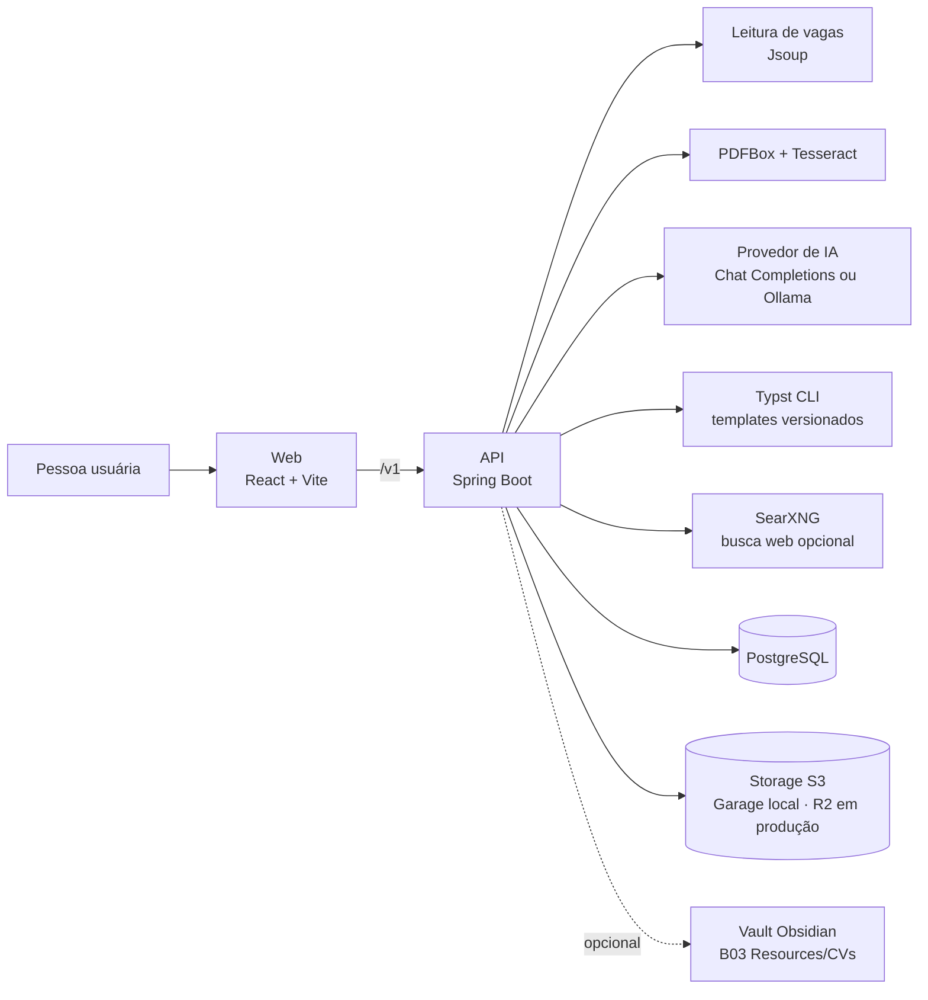
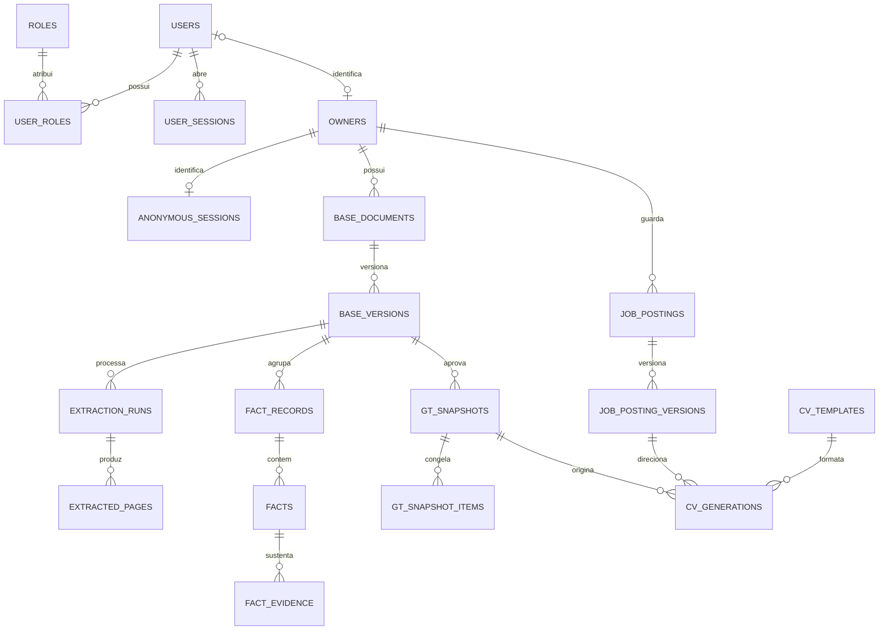

# Arquitetura

O Tailorly gera currículos personalizados para cada vaga a partir de um **Currículo Base revisado**
(o Ground Truth). Este documento mostra as peças, o que cada pasta do repositório faz e o modelo de
dados. Para as regras de produto, comece por [Currículo Base como Ground Truth](product/ground-truth.md).

## Fluxo

Receber e validar o Currículo Base → aprovar os fatos como Ground Truth → receber a vaga → extrair
os requisitos → montar o documento só com fatos aprovados (e evidências confirmadas) → compilar o
template Typst em PDF e gerar o Markdown → guardar os artefatos conforme o tipo de sessão →
opcionalmente exportar para o vault.

## Estrutura do repositório

| Caminho                                           | Papel                                                                                    | Documentação                                          |
| ------------------------------------------------- | ---------------------------------------------------------------------------------------- | ----------------------------------------------------- |
| `apps/web`                                        | Interface React: upload, revisão dos fatos, gerador com prévia Typst, histórico e perfil | [`apps/web/README.md`](../apps/web/README.md)         |
| `services/api`                                    | API Spring Boot: contas, extração, revisão, vagas, geração e due diligence               | [`services/api/README.md`](../services/api/README.md) |
| `services/searxng`                                | Configuração do SearXNG local usado na busca web (opcional)                              | [Desenvolvimento](development.md)                     |
| `docs`                                            | Documentação de produto, arquitetura, desenvolvimento e deploy                           | [`docs/README.md`](README.md)                         |
| `compose.yaml`                                    | PostgreSQL 17, Garage (S3), Garage UI e SearXNG para desenvolvimento local               | [Desenvolvimento](development.md)                     |
| `render.yaml`                                     | Blueprint do serviço da API no Render                                                    | [Deploy](deploy.md)                                   |
| `turbo.json`, `pnpm-workspace.yaml`, `biome.json` | Orquestração do monorepo e lint/format compartilhados                                    | —                                                     |
| `.github/workflows`                               | CI: lint, testes da API, build da web e testes e2e                                       | [Desenvolvimento](development.md#ci)                  |

## Em produção e em desenvolvimento

| Peça     | Desenvolvimento local                       | Produção                                        |
| -------- | ------------------------------------------- | ----------------------------------------------- |
| Web      | Vite em `localhost:5173` com proxy de `/v1` | Vercel (build estático)                         |
| API      | `pnpm dev` (perfil `local`)                 | Docker no Render                                |
| Banco    | PostgreSQL do `compose.yaml`                | Neon                                            |
| Arquivos | Garage (S3 local)                           | Cloudflare R2                                   |
| IA       | `rules`, Ollama ou provedor remoto          | Provedor remoto compatível com Chat Completions |
| Typst    | Imagem Docker via `bin/typst-docker`        | Instalado na imagem da API                      |
| Vault    | Opcional (`TAILORLY_VAULT_*`)               | Desligado                                       |

## Frontend e API em uma página

- **Web:** React 19, TypeScript, Vite 7, Tailwind 4, TanStack Router/Query e Zustand. Estado de
  interface é sempre derivado do servidor: `sessionStorage` e as stores nunca são fonte de verdade
  de fatos, cotas ou cache de OCR. Detalhes em [`apps/web`](../apps/web/README.md#documentação).
- **API:** Java 21, Spring Boot 3.5, PostgreSQL com Flyway, storage S3, OpenAPI. Pacotes por domínio
  de negócio. Detalhes em [`services/api`](../services/api/README.md#documentação).
- **Contrato:** o frontend consome `services/api/openapi/tailorly.json` e gera o cliente com o Orval
  (`pnpm api:sync`).

## Modelo de dados

Tabelas existentes (migrations em `services/api/src/main/resources/db/migration`, V1–V25):

| Grupo               | Tabelas                                                                       | Responsabilidade                                                                                                                                                              |
| ------------------- | ----------------------------------------------------------------------------- | ----------------------------------------------------------------------------------------------------------------------------------------------------------------------------- |
| Contas e acesso     | `users`, `roles`, `user_roles`, `user_sessions`                               | Credenciais, papéis e sessões de refresh token (uma conta pode ter várias; `rotated_from` permite detectar reuso).                                                            |
| Owners e visitantes | `owners`, `anonymous_sessions`                                                | Identidade proprietária dos dados (conta ou anônima). `active_snapshot_id` aponta para o Ground Truth ativo; a sessão anônima guarda hash do token, TTL e contadores de cota. |
| Arquivos            | `stored_objects`, `base_documents`                                            | Metadados do storage e documentos originais (hash único por owner).                                                                                                           |
| Extração            | `base_versions`, `extraction_runs`, `extracted_pages`                         | Versões do Currículo Base, fila persistente de extração e texto por página (no storage).                                                                                      |
| Fatos e revisão     | `fact_records`, `facts`, `fact_evidence`, `review_issues`, `review_decisions` | Fatos propostos com evidência, pendências e decisões auditadas (`pendente`, `confirmado`, `corrigido`, `omitido`).                                                            |
| Ground Truth        | `gt_snapshots`, `gt_snapshot_items`                                           | Snapshot imutável dos fatos aprovados, com hash; a geração só lê daqui.                                                                                                       |
| Vagas               | `job_postings`, `job_posting_versions`                                        | Vaga por owner e versões imutáveis (leitura + análise por IA).                                                                                                                |
| Geração             | `cv_templates`, `cv_generations`                                              | Templates Typst versionados e histórico de gerações com as versões de snapshot, vaga e template usadas.                                                                       |
| Evidências          | `cv_supplementary_evidence`, `cv_evidence_link_checks`                        | Evidência complementar com fonte e trecho, e controle de links já analisados.                                                                                                 |
| Perfil              | `ai_preferences`, `owner_generation_defaults`, `owner_vaults`                 | Preferências de IA (chaves criptografadas), padrões de geração e vault do Second Brain por conta.                                                                             |
| Due diligence       | `company_due_diligence`                                                       | Relatório imutável por consulta, sem vínculo com o Ground Truth.                                                                                                              |

Regras de retenção e exclusão cobrem arquivo original, texto extraído, fatos, pendências, snapshots e
os currículos gerados a partir deles; veja [Currículo Base como Ground Truth](product/ground-truth.md).
